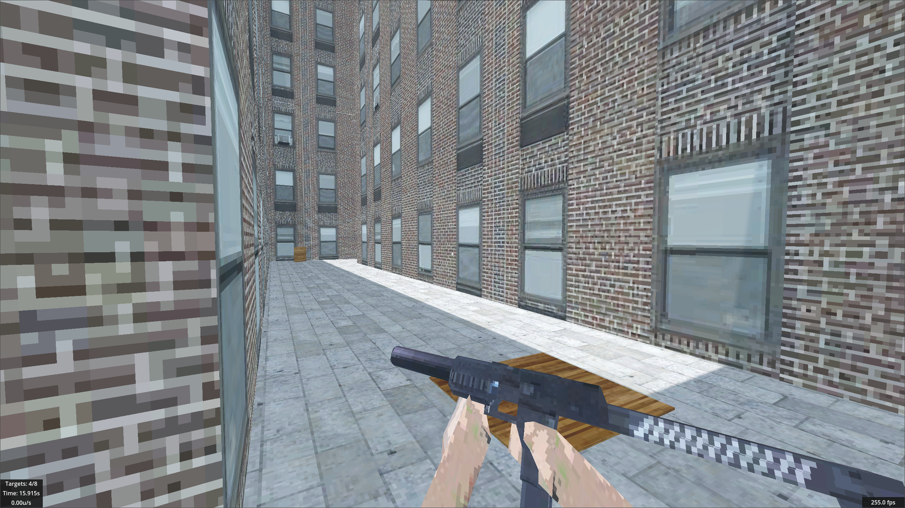
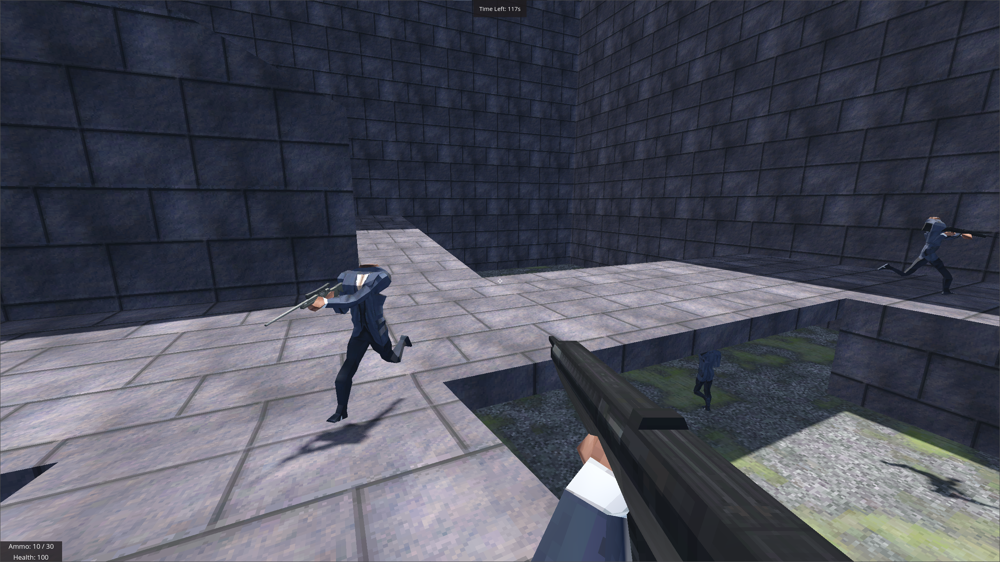
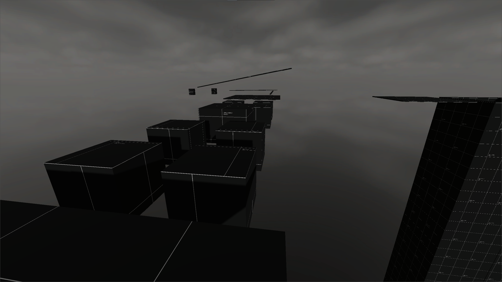

# Straif

Straif is a fast-paced 3D platforming shooter where you race through a variety of hand crafted maps to achieve the fastest time on the global leaderboard.

It is heavily inspired by source engine games such as Counter Strike: Source, leaving a high skill ceiling for players to compete.

## Quick Links
- [Website](#website)
- [Web Api](#web-api)
- [Configuration](#configuration)
- [Screenshots](#screenshots)
- [Local Setup](#local-setup)
- [Steam Deployment](#steam-deployment)

## Website

The Straif website includes a trailer-led game overview and complete Movement,
Target, Aim, and Overall leaderboards at
[straif.pumped.software](https://straif.pumped.software/).

Run it locally:

```bash
cd website
pnpm install
pnpm dev
```

## Web Api
The straif [web api](https://straifapi.pumped.software) is public and [documentation](https://straifapi.pumped.software/docs) can be viewed as well.

## Configuration

Configuration is kept separate for the game, API, website, and Steam upload
tools. Copy the relevant example file before running that component.

### API server variables

Copy `server/.env.example` to `server/.env`:

| Variable | Required | Description |
| --- | --- | --- |
| `DATABASE_URL` | Local development | PostgreSQL connection string. Docker Compose supplies its internal value. |
| `VERSION` | Yes | Client version accepted by the API. |
| `STEAM_API_KEY` | Yes for authenticated requests | Steam Web API key used to validate game tickets. |
| `DISCORD_TOKEN` | No | Discord bot token. Discord integration is skipped when unset. |
| `PORT` | Yes | API listening port, normally `3000`. |

The database service in `server/compose.yaml` uses the fixed Docker settings
`POSTGRES_USER=postgres`, `POSTGRES_PASSWORD=root`, and `POSTGRES_DB=straif`.

### Website variables

Copy `website/.env.example` to `website/.env` when the website needs a custom
API endpoint:

| Variable | Required | Description |
| --- | --- | --- |
| `VITE_API_BASE_URL` | No | API base URL. Defaults to the public Straif API. |

### Game-server Docker variables

Dedicated game servers receive these variables through
`docker/game-servers.compose.yaml` or `scripts/game-server-docker.sh`:

| Variable | Description |
| --- | --- |
| `SERVER_NAME` | Name shown in the server browser. |
| `PORT` | ENet UDP port. |
| `MAX_PLAYERS` | Maximum connected players. |
| `MODE` | `deathmatch` or `elimination`. |

### Steam deployment variables

Copy `steam/steam.env.example` to `steam/steam.env` before uploading builds:
`STEAM_USERNAME`, `STEAM_DEPOT_WINDOWS`, `STEAM_DEPOT_LINUX`, and
`STEAM_DEPOT_MACOS` are required by the upload script. `STEAMCMD` is optional
and defaults to `~/.local/steamcmd/steamcmd.sh`.

The deployment script also accepts `DROPLET_HOST` (required) and
`DROPLET_PATH` (optional, default `~/straif-game-servers`). Export scripts use
`GODOT` when set, while tests use `GODOT_BIN`.

The Godot client does not require a `.env` file. Its API URL and version are
stored in `settings-dev.json` for editor runs and `settings-prod.json` for
exports.

## Screenshots




## Local Setup

### Game Client
```bash
git clone https://github.com/vasiltop/straif
cd straif
godot -e
```

Requires Godot 4.6.1. Run `./scripts/setup-dev.sh` to install development
dependencies and Git hooks. Run `./scripts/test-godot.sh` for the Godot test
suite and `./scripts/test-e2e.sh` for the multi-process ENet test.

If Steam or the API is unavailable, choose **Play Offline** from the server
browser or maintenance screen. Offline mode supports local speedrun, movement,
and aim practice; leaderboard and score submission features are disabled.
It can also be selected from the command line with:

```bash
godot -- --offline
```

### Hosting a game server

The game executable can be ran as a game server as well by providing the following arguments.

```bash
./straif server <name> <port> <max_players> <mode> --headless

# for example
./straif server DM-1 3005 5 deathmatch --headless
```

This will continously ping the server browser to let other players know your server is online.

#### Dockerized game servers

Game servers run in Docker, but the Godot binary is **built on your dev machine** and only copied
into a tiny image — so even a small (2 GB) droplet never has to run a memory-hungry export.

Build the Linux binary once, then run one or many servers:

```bash
./scripts/export-linux.sh                       # produces build/linux/straif.x86_64

# a single ad-hoc server
./scripts/game-server-docker.sh DM-1 3005 8 deathmatch

# a managed fleet (edit docker/game-servers.compose.yaml to add/remove servers)
docker compose -f docker/game-servers.compose.yaml up -d --build
```

Ports are UDP (Godot ENet). Add a server by copying a service block in
`docker/game-servers.compose.yaml` with a unique name and port.

##### Deploying to a droplet

`deploy-game-servers.sh` builds the binary locally, ships it over SSH, and rebuilds/restarts the
servers on the droplet:

```bash
DROPLET_HOST=root@1.2.3.4 ./scripts/deploy-game-servers.sh
```

### Server

The database, server, and migrations are packaged into a single Docker Compose config.
From the `server/` directory:

```bash
cd server
cp .env.example .env   # fill in STEAM_API_KEY and DISCORD_TOKEN
docker compose up -d --build
```

This builds the server image, waits for Postgres, applies the committed migrations, and starts
the API on `http://localhost:3000`. Re-run the same command to deploy updates.

#### Local development (without Docker)

To run the server directly against the Dockerized database:

```bash
cd server
cp .env.example .env
docker compose up -d db
corepack enable
pnpm install --frozen-lockfile
pnpm db:push
pnpm dev
```

## Steam Deployment

### One-time setup

Install SteamCMD:

```bash
mkdir -p ~/.local/steamcmd
curl -sqL "https://steamcdn-a.akamaihd.net/client/installer/steamcmd_linux.tar.gz" \
  | tar -xzf - -C ~/.local/steamcmd
```

```bash
~/.local/steamcmd/steamcmd.sh +login YOUR_STEAM_USERNAME
```

Copy the env file and fill in your depot IDs from the [Steamworks depots page](https://partner.steamgames.com/apps/depots/3850480):

```bash
cp steam/steam.env.example steam/steam.env
```

Set `STEAM_DEPOT_WINDOWS`, `STEAM_DEPOT_LINUX`, and `STEAM_DEPOT_MACOS`
to the matching depot IDs from Steamworks.

### Upload a build

```bash
./scripts/export-macos.sh                # macOS only
./scripts/export-all.sh                  # Linux, Windows, and macOS
./scripts/upload-steam.sh
```

To export all platforms and upload them in one command, run
`./scripts/upload-steam.sh --build`. Steam uploads the platform build
directories, including the runnable `build/macos/Straif.app` bundle.
